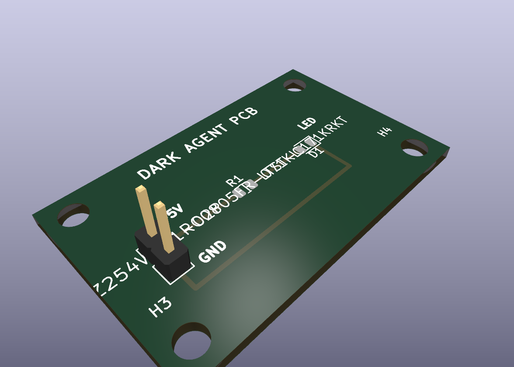

# Dark-Agent-PCB

Agent-ready KiCad 10 PCB workspace from [DarkLabsStudio](https://github.com/DarkLabsStudio).

This repository gives coding agents a complete, verifiable electronics workflow:
schematic capture, PCB layout, BOM generation, Gerber and drill export, pick-and-place
data, and 3D previews. It is deliberately small enough to inspect and strict enough to
trust.

## Companion repository

This repository covers electronics. Its mechanical companion is
**[Dark-Agent-CAD](https://github.com/DarkLabsStudio/Dark-Agent-CAD)** — an agent-ready
build123d workspace with watertight-geometry verification, STEP export, and headless
VTK previews.

Use **Dark-Agent-PCB** for the board and **Dark-Agent-CAD** for the enclosure, brackets,
cooling blocks, fixtures, or mounting interfaces around it. The two repositories share
the same agent-first, verify-before-report workflow.



## What is included

- **KiCad 10 reference project** with a schematic, two-layer PCB, BOM, Gerbers, drill
  files, position data, and rendered previews.
- **A dependency-free verification runner** that drives `kicad-cli` through ERC, DRC,
  schematic parity, netlist, BOM, Gerber, drill, position, and 3D-render checks.
- **An agent contract** in [`setup.md`](setup.md) that tells an agent how to clone the
  repository, validate the baseline, create a new board, and report results.
- **MIT-licensed source and project files.** KiCad itself is an external GPL-3.0
  application; no KiCad binaries or libraries are vendored here.

## Reference board

The checked-in example is a minimal, practical LED indicator:

| Item | Value |
| --- | --- |
| Board size | 40 mm x 25 mm |
| Layers | 2 copper layers, 1.6 mm thick |
| Power input | 2-pin 2.54 mm through-hole header (`J1`) |
| Current limit | 1 kOhm 0805 resistor (`R1`) |
| Indicator | Red 0805 LED (`D1`) |
| Mounting | Four M3 non-plated mounting holes (`H1`-`H4`) |
| Nets | `+5V`, `GND`, `Net-(D1-A)` |

Reference verification with KiCad 10.0.8:

- ERC: **0 errors**, 19 library-configuration warnings in the headless CLI
- DRC: **0 errors**, **0 unconnected items**, **0 schematic-parity issues**
- 17 DRC warnings (silkscreen/library-environment warnings; no electrical errors)
- BOM: 3 line items, including manufacturer part numbers
- Fabrication exports: 10 Gerber/job files, PTH and NPTH drill files, drill maps,
  drill report, and position CSV
- Previews: top, bottom, and isometric PNG renders

The runner fails on ERC/DRC errors, unconnected items, and schematic-parity
mismatches. Warnings are printed and counted but do not fail the run.

## Requirements

- **KiCad 10.0.x**, including `kicad-cli`. The reference was validated with 10.0.8.
- **Python 3.10+** for `scripts/runner.py`. The runner uses only the Python standard
  library.
- Optional: the KiCad 10 GUI for interactive schematic and PCB editing.

`kicad-cli` is not always added to `PATH`. The runner searches common Windows, macOS,
and Linux locations, or you can point to it explicitly:

```powershell
$env:KICAD_CLI = "C:\Users\<you>\AppData\Local\Programs\KiCad\10.0\bin\kicad-cli.exe"
```

```bash
export KICAD_CLI="/Applications/KiCad/KiCad.app/Contents/MacOS/kicad-cli"
```

If KiCad is missing, stop and ask the human before installing it. Do not install
system packages or optional tools silently.

## Quick start

```bash
git clone https://github.com/DarkLabsStudio/Dark-Agent-PCB.git
cd Dark-Agent-PCB
python scripts/runner.py examples/led_indicator
```

On Windows, `py -3.12` is also fine:

```powershell
py -3.12 scripts/runner.py examples/led_indicator
```

The runner writes fresh verification artifacts to `exports/led_indicator/` and
`renders/led_indicator/`. The checked-in `examples/led_indicator/bom.csv`,
`gerbers/`, and `previews/` are the canonical example artifacts.

To regenerate the canonical artifacts from the current project:

```bash
python scripts/runner.py examples/led_indicator --refresh
```

## Agent prompt

Copy this prompt into an agent session:

```text
You are working in an agent-ready KiCad 10 PCB repository.

First clone the repository and enter it:

  git clone https://github.com/DarkLabsStudio/Dark-Agent-PCB.git
  cd Dark-Agent-PCB

Then read setup.md in full and follow it. Do not skip the baseline verification:
run scripts/runner.py against examples/led_indicator and confirm the expected PASS
result before creating or changing any board.

If KiCad 10 or kicad-cli is missing, stop and ask the human for permission before
installing anything. Use the question tool for approvals and choices. Do not install
system packages or optional dependencies silently.

For a new board, copy the reference project into a new directory under projects/,
update the schematic and PCB in KiCad 10, keep the board outline closed on
Edge.Cuts, run "Update PCB from Schematic" after schematic changes, and set MPN and
Description fields so schematic-parity checks pass.

When finished, run:

  python scripts/runner.py projects/<board_name> --refresh

Report the runner result, ERC/DRC error counts, unconnected and schematic-parity
counts, the paths to the BOM, Gerbers, drill files, position data, previews, and any
warnings or fabrication caveats.
```

## Create a new board

The reference project is intentionally copyable. A reliable workflow is:

1. Copy `examples/led_indicator/` to `projects/<board_name>/`.
2. Rename the project, schematic, and PCB files to the same base name and update the
   `meta.filename` value in the `.kicad_pro` file.
3. Open the project in KiCad 10. Edit the schematic, assign official KiCad footprints,
   and update the PCB from the schematic.
4. Route the PCB, keep the Edge.Cuts outline closed, and add mounting holes as
   schematic symbols if they are present on the board.
5. Run the verification runner with `--refresh` to regenerate the BOM, Gerbers, drill
   files, position data, and previews.
6. Commit the source files, BOM, Gerbers, and previews together.

See [`setup.md`](setup.md) for the full agent workflow, acceptance checklist, manual
`kicad-cli` commands, and troubleshooting.

## Repository layout

```text
Dark-Agent-PCB/
├── README.md
├── setup.md
├── LICENSE
├── scripts/
│   └── runner.py
├── projects/
│   └── README.md
└── examples/
    └── led_indicator/
        ├── led_indicator.kicad_pro
        ├── led_indicator.kicad_sch
        ├── led_indicator.kicad_pcb
        ├── bom.csv
        ├── gerbers/
        ├── previews/
        └── README.md
```

Generated `exports/` and `renders/` directories are ignored by git.

## Fabrication notes

The Gerbers, drill files, and BOM in `examples/led_indicator/` describe the reference
board only. Always inspect the rendered previews and run the verification runner
before sending any fabrication order. The board uses standard KiCad footprints and
0805 passives, a 2.54 mm header, and non-plated M3 mounting holes.

## License

The contents of this repository are released under the [MIT License](LICENSE).
KiCad is a separate GPL-3.0 application and is not bundled here. KiCad symbol,
footprint, and 3D-model libraries are referenced by name from an installed KiCad 10.
