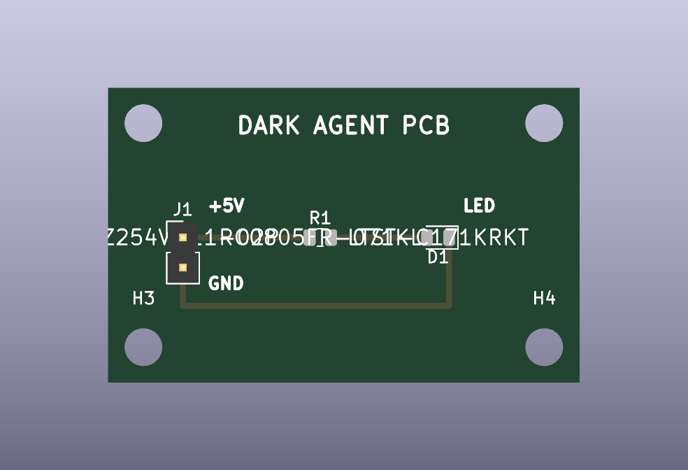
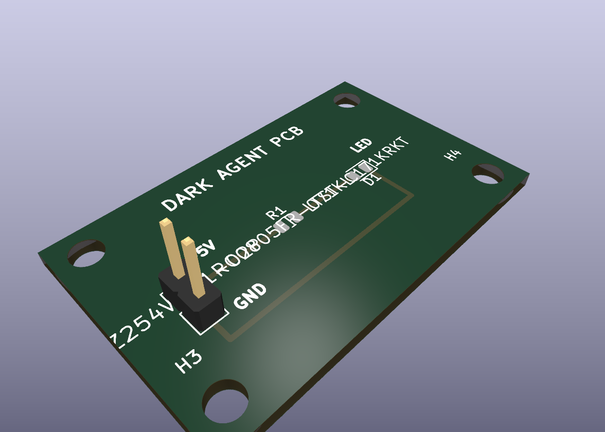

# LED indicator reference board

A minimal KiCad 10 project that demonstrates the full Dark-Agent-PCB workflow:
schematic, PCB, BOM, Gerbers, drill files, position data, and 3D previews.





## Design

| Item | Value |
| --- | --- |
| Board size | 40 mm x 25 mm |
| Layers | 2 copper layers |
| Thickness | 1.6 mm |
| Power input | `J1`, 2-pin 2.54 mm vertical pin header |
| Current limit | `R1`, 1 kOhm 0805 |
| Indicator | `D1`, red 0805 LED |
| Mounting | `H1`-`H4`, M3 non-plated holes |
| Nets | `+5V`, `GND`, `Net-(D1-A)` |

The schematic uses KiCad's official `Connector_Generic:Conn_01x02`,
`Device:R`, `Device:LED`, `power:+5V`, `power:GND`, `power:PWR_FLAG`, and
`Mechanical:MountingHole` symbols. The PCB uses the corresponding official
`Connector_PinHeader_2.54mm`, `Resistor_SMD`, `LED_SMD`, and `MountingHole`
footprints.

`PWR_FLAG` symbols mark the `+5V` and `GND` nets as driven for ERC. They are schematic
annotation symbols only and do not appear on the board or in the BOM. `H1`-`H4` are
non-plated mounting holes and are intentionally excluded from the BOM.

## Files

| Path | Purpose |
| --- | --- |
| `led_indicator.kicad_pro` | KiCad project |
| `led_indicator.kicad_sch` | Schematic |
| `led_indicator.kicad_pcb` | PCB layout |
| `bom.csv` | Grouped bill of materials with MPNs |
| `gerbers/` | Gerbers, drill files, drill maps, drill report, and position CSV |
| `previews/` | Top, bottom, and isometric 3D renders |

## BOM

The BOM contains three line items:

| Refs | Value | Footprint | MPN | Qty |
| --- | --- | --- | --- | --- |
| D1 | Red LED | `LED_SMD:LED_0805_2012Metric` | LTST-C171KRKT | 1 |
| J1 | 5V input | `Connector_PinHeader_2.54mm:PinHeader_1x02_P2.54mm_Vertical` | PZ254V-11-02P | 1 |
| R1 | 1k | `Resistor_SMD:R_0805_2012Metric` | RC0805FR-071KL | 1 |

## Verification

From the repository root:

```bash
python scripts/runner.py examples/led_indicator
```

The reference result with KiCad 10.0.8 is:

- ERC: 0 errors, 19 library-configuration warnings
- DRC: 0 errors, 17 silkscreen/library-environment warnings
- Unconnected items: 0
- Schematic-parity issues: 0
- BOM: 3 line items
- Gerbers: 10 files, including a Gerber job file
- Drill: PTH and NPTH files, maps, and report
- Position: `gerbers/positions.csv`
- Previews: `previews/top.png`, `previews/bottom.png`, `previews/iso.png`

The warnings are non-electrical. They come from running `kicad-cli` headlessly without
the GUI's global library configuration and from standard silkscreen clearances. The
runner treats ERC/DRC errors, unconnected items, and schematic-parity mismatches as
failures.

To regenerate the checked-in artifacts after editing:

```bash
python scripts/runner.py examples/led_indicator --refresh
```

## Fabrication

The `gerbers/` directory includes:

- `led_indicator-F_Cu.gtl`
- `led_indicator-B_Cu.gbl`
- `led_indicator-F_Mask.gts`
- `led_indicator-B_Mask.gbs`
- `led_indicator-F_Silkscreen.gto`
- `led_indicator-B_Silkscreen.gbo`
- `led_indicator-F_Paste.gtp`
- `led_indicator-B_Paste.gbp`
- `led_indicator-Edge_Cuts.gm1`
- `led_indicator-job.gbrjob`
- `led_indicator-PTH.drl` and `led_indicator-NPTH.drl`
- Drill maps, drill report, and `positions.csv`

This is a reference design, not a certified product. Inspect the previews and run the
verification runner before ordering fabrication.
